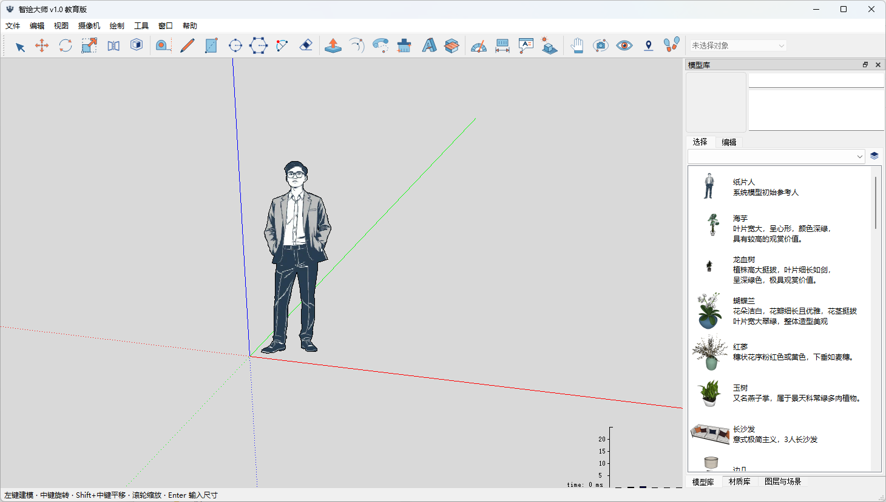

# DeepDraw 引擎

[中文](README.md) | [English](README_en.md)

官网：[www.archieast.com](https://www.archieast.com)

DeepDraw 是一款 SketchUp 的替代产品，也是一款中国产的轻量化通用三维图形引擎。

采用与 SketchUp 尽可能一致的技术路径，核心算法和数据结构与 SketchUp 保持一致，旨在不改变用户习惯，让现有项目无缝迁移。



## 国家战略
中国有大量建筑设计、城市更新、室内设计和工程项目，方案推敲与三维表达的需求贯穿日常工作。国家统计局的第五次全国经济普查公报记录了建筑业的庞大体量。住房和城乡建设部等部门《关于推动智能建造与建筑工业化协同发展的指导意见》提出，要突破专用软件等关键技术，积极应用自主可控的 BIM 技术，并建设数字设计基础平台和集成系统。

## 基石计划
中国作为世界第一的工业大国，工业设计软件长期没有自己的产品，依赖国外的厂商，受制于欧美，这就像高耸入云的摩天大楼，但是根基还需要补充。我们发起了一个名为“基石计划”的倡议，计划将在未来10年内，平替所有在中国销售的工业设计软件，十年铸基，撑起中国工业的自主未来。包括: Rhino AutoCAD Soildworks UG MATLAB

## 产品对比

本项目 与 [IngeTrazo](https://github.com/ingelibre/ingetrazo) 的产品定位高度重合，但采用了不同的技术路径。

| 产品 | 所属 | 价格 | 技术栈 | 特点 |
| --- | --- | --- | --- | --- |
| DeepDraw | 中国 · 深度智绘（上海） | 免费 | Python + Qt5，核心部分使用 C++ | 底层算法采用 C++ 开发，注重性能，技术实现尽可能与 SketchUp 保持一致 |
| IngeTrazo | 秘鲁 | 免费 | Python + Qt6 | 纯 Python 编写 |

## 启动

双击 `start_education.cmd`，或使用配置好的 Python 3.8 运行：

```console
C:\python\Python38\python.exe editor.py
```

`editor.py` 是唯一启动入口；也保留为 Eric IDE 的启动文件。`DEEPDRAW_EDUCATION_PYTHON` 可以指定解释器。依赖见 `requirements-education.txt`。

## 目录

| 目录 | 职责 |
| --- | --- |
| `app/` | 程序启动、主窗口、Qt 界面及插件管理 |
| `app/ui/` | Designer `.ui`、对应控制器、生成的 `Ui_*.py` 和 Qt 资源模块 |
| `editing/` | 人工编辑事务、撤销、分组、剪贴板、文字与材质操作 |
| `engine/` | 原生绑定、DAI 编解码、几何工具及渲染 |
| `engine/tools/` | 当前使用的人工交互工具，每种工具仅保留一份实现 |
| `engine/viewer/` | 视图区、相机、剖切、标注显示和阴影 |
| `engine/native/cp38/` | 配套的原生几何和渲染二进制 |
| `assets/` | 教育版图标与 Qt 资源清单 |
| `data/` | 现有模型、材质及素材数据；整理过程不修改这些文件 |
| `importers/sketchup/` | 使用当前引擎的独立 SKP 导入进程、pybind11 模块及 SDK DLL |
| `native/sketchup/` | suapi、suapi_extra、skp_exporter 的 pybind11/CMake 源码、SDK 与回归检查 |
| `plugins/` | 兼容当前教育版的扩展入口；废弃旧插件已删除 |
| `scripts/` | 开发工具 |
| `tests/` | 文件格式和真实 Qt/OpenGL 回归检查 |
| `packaging/` | 独立 PyInstaller 打包配置 |
| `runtime/` | 测试截图、报告和构建产物，不存放源代码 |
| `docs/` | 架构、迁移来源、整理记录及素材校验记录 |

## 环境部署

目前仅支持 **Windows 下的 CPython 3.8 64 位（x64）**。项目自带的原生扩展与 Python 3.8 x64 配套，不支持其他 Python 版本或 32 位解释器。

1. 安装 Python 3.8 64 位，建议安装到 `C:\python\Python38`。
2. 在项目根目录执行以下命令，安装运行依赖：

   ```console
   C:\python\Python38\python.exe -m pip install -r requirements-education.txt
   ```

   运行依赖包括 PySide2、PyOpenGL、NumPy 和 Pillow，版本要求见 `requirements-education.txt`。

3. 保留项目自带的 `engine/native/cp38/` 和 `importers/sketchup/` 中的原生扩展及配套 DLL。
4. 双击 `start_education.cmd` 启动程序。如果 Python 安装在其他位置，可将环境变量 `DEEPDRAW_EDUCATION_PYTHON` 设置为该 Python 3.8 64 位解释器的完整路径。
